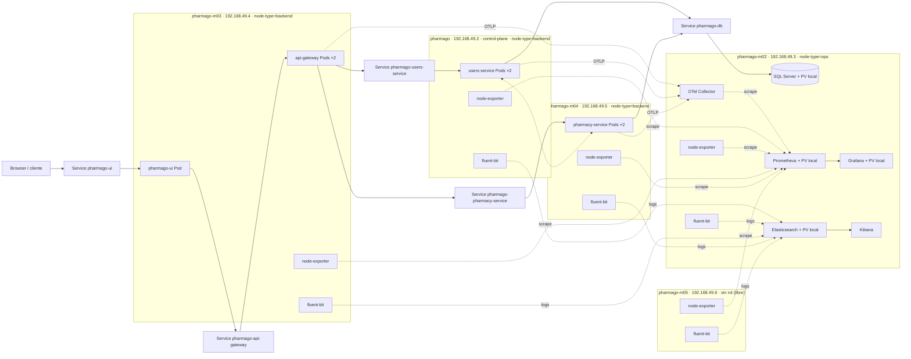

# Topología de despliegue de PharmaGo en Kubernetes

Ubicación real de los Pods en el cluster `pharmago` (minikube, 5 nodos), observada el 21/10/2026 con `kubectl get pods -n pharmago -o wide`.

## Justificación

- **Un microservicio por nodo:** los tres Deployments de backend tienen una `podAntiAffinity` obligatoria por `kubernetes.io/hostname` que impide que dos microservicios distintos compartan nodo. Si no hay nodo válido, el Pod queda `Pending` en vez de violar la regla.
- **Dos réplicas juntas:** una `podAffinity` con su propio `app` mantiene las 2 réplicas de cada servicio en el mismo nodo. Cubren la falla de un Pod y los `RollingUpdate` sin caída, pero no la caída del nodo entero.
- **Nodo `ops`:** la base de datos y la observabilidad están fijadas con `nodeAffinity`, porque sus PersistentVolumes son `hostPath` (disco local del nodo). Así también quedan aisladas de la carga de negocio.
- **DaemonSets:** node-exporter y fluent-bit corren en todos los nodos para recolectar métricas y logs.
- **Alcance:** en qué nodo `backend` cae cada servicio lo decide el scheduler y puede cambiar entre despliegues. Lo que está garantizado es la separación. Los 5 nodos son contenedores de minikube sobre una sola máquina física: el despliegue demuestra separación entre nodos Kubernetes, no entre hosts físicos.
