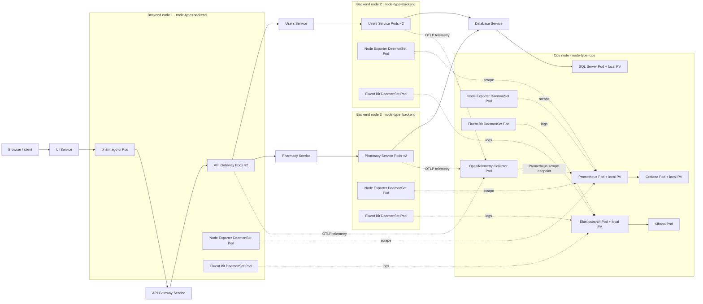

# PharmaGo Kubernetes deployment topology

This is the target placement represented by the manifests. Replace the generic node names with the names shown by `kubectl get nodes -L node-type` when preparing the project evidence.

A required Pod anti-affinity rule keeps different backend microservices on different `kubernetes.io/hostname` values, and a required Pod affinity keeps the two replicas of each microservice together on its node. The diagram shows Kubernetes node separation. Multiple Minikube nodes on one laptop are still backed by one physical machine; use separate physical hosts if the grading requirement demands physical-machine separation.
